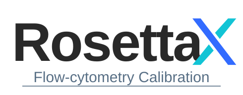

RosettaX
========

.. list-table::
   :widths: 35 65
   :header-rows: 1

   * - Badge
     - Status
   * - Python versions
     - |mps-python|
   * - Documentation
     - |mps-docs|
   * - Continuous integration
     - |mps-ci|
   * - Test coverage
     - |mps-coverage|
   * - PyPI package
     - |mps-pypi|
   * - PyPI downloads
     - |mps-downloads|
   * - Anaconda package
     - |mps-conda|
   * - Anaconda downloads
     - |mps-conda-downloads|
   * - Latest Anaconda release
     - |mps-conda-release|
   * - Zenodo DOI
     - |mps-zenodo|

Interactive fluorescence and scattering calibration workflows for flow cytometry.

Use a bead-standard FCS recording to calibrate a flow cytometer. The fluorescence
workflow pairs measured peaks with reference intensities such as MESF. The
scattering workflow fits measured peaks against modeled or tabulated standards.
Review the fit, save the calibration as JSON, and apply it to other FCS files.

After installation, run ``rosettax`` to open the local browser interface, or
``rosettax --fcs-file-path sample.fcs`` to start with a recording.
The `quick-start guide <https://martinpdes.github.io/RosettaX/quickstart.html>`_
walks through both fits and links to worked Python examples. See the
`privacy policy <https://martinpdes.github.io/RosettaX/privacy.html>`_ for file storage details.

Installation
------------

Requires Python ``>=3.11``.

.. code-block:: console

   $ python -m pip install RosettaX

Install from the ``martinpdes`` Conda channel:

.. code-block:: console

   $ conda install -c martinpdes rosettax

For an editable source installation:

.. code-block:: console

   $ git clone https://github.com/MartinPdeS/RosettaX.git
   $ cd RosettaX
   $ python -m pip install -e .

Documentation
-------------

Read the `RosettaX documentation <https://martinpdes.github.io/RosettaX/>`__.

Supported cytometers
--------------------

The `cross-device validation report <https://github.com/MartinPdeS/RosettaX/blob/HEAD/VALIDATION.md>`_
lists results for individual recordings from these instruments. Some recordings
exercise warning behavior when too few peaks resolve for automatic sizing.

.. supported-cytometers-start

.. list-table::
   :header-rows: 1
   :widths: 28 72

   * - Manufacturer
     - Cytometer models
   * - Apogee
     - A50 Micro, A60 Micro, MicroPLUS
   * - BD
     - FACSCalibur, FACSCelesta SORP, FACSLyric, FACSymphony A1, FACSymphony A5
   * - Beckman Coulter
     - CytoFLEX LX, CytoFLEX S, MoFlo Astrios
   * - Cytek
     - Aurora, Northern Lights
   * - Miltenyi Biotec
     - MACSQuant Analyzer 16
   * - Sony
     - ID7000

.. supported-cytometers-end

Citation
--------

Cite RosettaX using DOI `10.5281/zenodo.19846629 <https://doi.org/10.5281/zenodo.19846629>`__.
The Zenodo record provides the citation in BibTeX and other formats.

Contributing
------------

See the `contributing guide <https://github.com/MartinPdeS/RosettaX/blob/HEAD/CONTRIBUTING.md>`__.

Contact
-------

* `Martin Poinsinet de Sivry-Houle <mailto:martin.poinsinet.de.sivry@gmail.com?subject=RosettaX>`__

`Project contact page <https://github.com/MartinPdeS>`__.

License
-------

RosettaX is distributed under ``AGPL-3.0-or-later``.

See the `license text <https://github.com/MartinPdeS/RosettaX/blob/HEAD/LICENSE>`__.

Commercial licensing, support, validation, or custom deployment agreements may
be discussed with the author.

.. |mps-python| image:: https://img.shields.io/pypi/pyversions/rosettax.svg
   :alt: Supported Python versions
   :target: https://pypi.org/project/rosettax/

.. |mps-pypi| image:: https://img.shields.io/pypi/v/rosettax.svg
   :alt: PyPI version
   :target: https://pypi.org/project/rosettax/

.. |mps-downloads| image:: https://img.shields.io/pypi/dm/rosettax.svg
   :alt: Monthly PyPI downloads
   :target: https://pypistats.org/packages/rosettax

.. |mps-docs| image:: https://github.com/MartinPdeS/RosettaX/actions/workflows/deploy_documentation.yml/badge.svg
   :alt: Documentation
   :target: https://martinpdes.github.io/RosettaX/

.. |mps-ci| image:: https://github.com/MartinPdeS/RosettaX/actions/workflows/deploy_coverage.yml/badge.svg
   :alt: Continuous integration
   :target: https://github.com/MartinPdeS/RosettaX/actions/workflows/deploy_coverage.yml

.. |mps-conda| image:: https://anaconda.org/martinpdes/rosettax/badges/version.svg
   :alt: Anaconda version
   :target: https://anaconda.org/martinpdes/rosettax

.. |mps-conda-downloads| image:: https://anaconda.org/martinpdes/rosettax/badges/downloads.svg
   :alt: Anaconda downloads
   :target: https://anaconda.org/martinpdes/rosettax

.. |mps-conda-release| image:: https://anaconda.org/martinpdes/rosettax/badges/latest_release_relative_date.svg
   :alt: Latest Anaconda release
   :target: https://anaconda.org/martinpdes/rosettax

.. |mps-zenodo| image:: https://zenodo.org/badge/DOI/10.5281/zenodo.19846629.svg
   :alt: Cite RosettaX on Zenodo
   :target: https://doi.org/10.5281/zenodo.19846629
